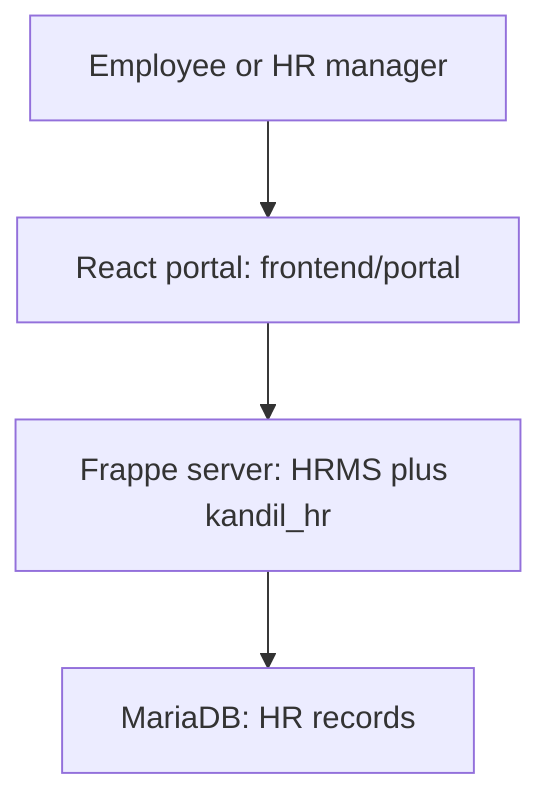

# Start here — how Kandil HR fits together

**Employees use our Kandil website. Frappe HR supplies existing HR capabilities. Our custom app supplies Kandil-specific rules.** These run together on the HR server with one HR database; Odoo remains independent.



| Folder | Meaning |
|---|---|
| `frontend/portal/` | The AR/EN website people see: forms, approvals and dashboard. |
| `kandil_hr/` | Our custom Frappe app: server-side business rules, data definitions, permission hooks and APIs. |
| `upstream/frappe/` | Clickable Git source link to the exact Frappe framework revision. |
| `upstream/erpnext/` | Clickable Git source link to the installed HR dependency. It does not replace Odoo. |
| `upstream/hrms/` | Clickable Git source link to the exact Frappe HR revision. |
| `deployment/` | Installation scripts, locked versions and dependency checks. |
| `docs/roadmap/` | Current delivery plan, task tracker and all 98 reference requirement allocations. |
| `docs/portal/` | Current connected portal walkthrough and recorded tests. |
| `docs/sprints/` | Earlier native implementation baseline and its evidence; older status text is historical. |
| `docs/archive/` | Historical research, proposals, designs and prototypes; not live application code. |

## What is inside our custom app?

- `portal/`: purpose-built API responses and draft operations for the React website.
- `recruitment/`: hiring requests, approvals, reservations, vacancies and related operations.
- `organization/`: positions, hierarchy, assignments, job descriptions and imports.
- `foundation/`: access rules, audit, delegation, private files and supporting controls.
- `kandil_hr/doctype/`: Frappe record definitions and controllers. Frappe calls these record types DocTypes; the repeated name is package/module structure, not another server.
- `www/`: website entry pages, including `/hr-portal`.
- `public/portal/`: compiled browser assets produced from `frontend/portal/`; normally edit the frontend source and rebuild, not these generated files by hand.
- `translations/`: translated application messages.
- `hooks.py`, `patches/` and `patches.txt`: connect custom behaviour and schema/data upgrades to Frappe.

## Where does it run?

The existing Bench has sibling source checkouts:

```text
frappe-bench/apps/
  frappe/       framework
  erpnext/      dependency
  hrms/         existing HR functionality
  kandil_hr/    THIS repository, including the React portal
```

`upstream/*` makes those external dependencies visible and version-controlled from this repo. A Git submodule stores the upstream URL and commit; its full source is fetched with `git clone --recurse-submodules` or `git submodule update --init --recursive`. It is not a private fork or a copy of all upstream history. The running Bench still uses the existing sibling clones. The installer creates the same relationship in a fresh environment using `deployment/versions.lock.json`.

## Example: submitting a request

1. React shows the form and sends the user's input using their personal Frappe session.
2. Our server checks the user's current scope, required fields, record version and capacity.
3. It saves the request and reservation in MariaDB, using the existing Frappe runtime.
4. Manager and HR decisions use the same server-enforced authority rules.
5. Final approval creates vacancies; React displays the saved result.

The browser cannot approve itself, edit capacity directly or grant access. Frappe Desk remains available for administration; ordinary users can stay in the custom portal for implemented workflows.

## How we add the rest

For each sprint: inspect what Frappe HR already supports → extend only the missing Kandil rules in the custom app → build the matching React screens → test real roles and negative cases → record evidence → commit and push → verify GitHub. Do not assume an existing stock feature meets the complete reference workflow without testing it.

Start with [the current sprint plan](roadmap/SPRINT_PLAN.md). This HR goal does not silently include tracking, estimating, payroll implementation, Odoo replacement or other company departments.
