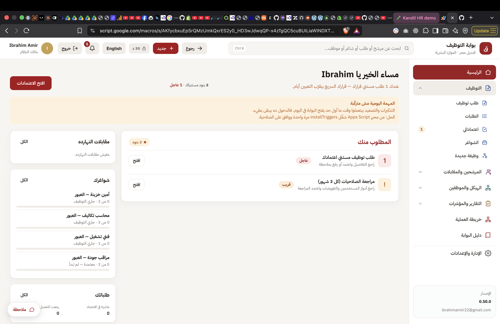
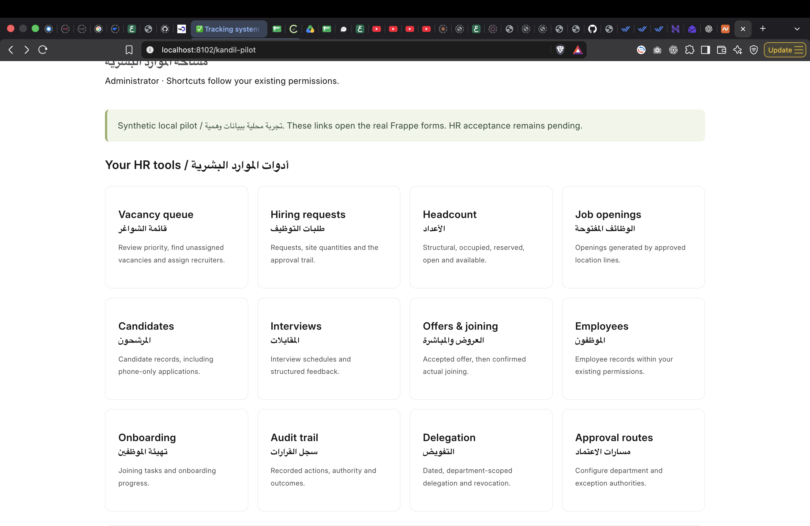
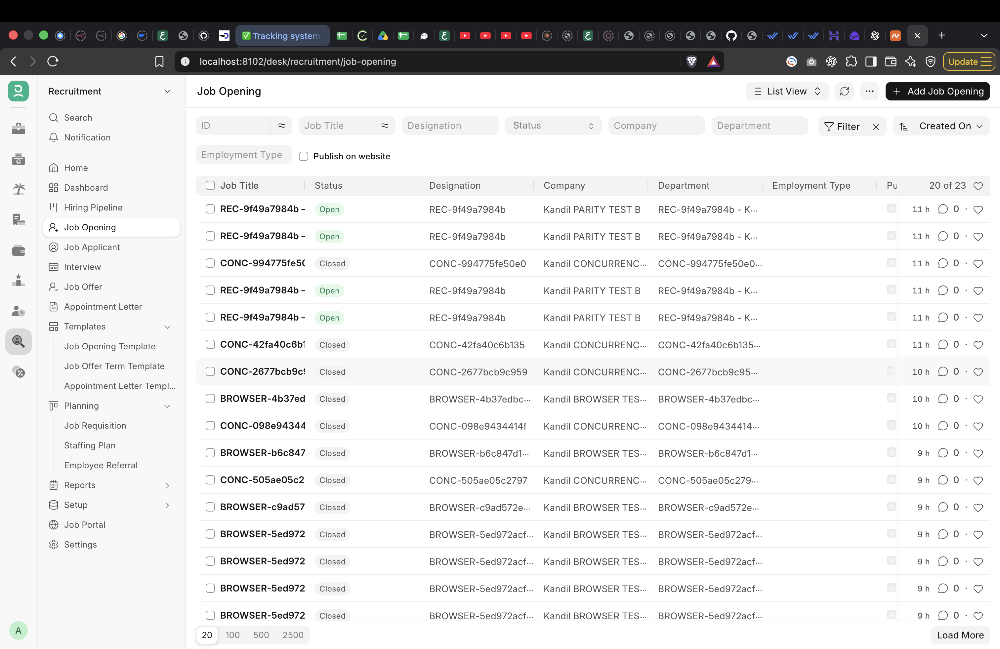

# قنديل | HR Web Platform

## 01 — القرار المقترح / Executive decision

**Architecture options, experience review and delivery plan · 12 October 2026 · Internal discussion draft v1.0**

**المطلوب:** بوابة موارد بشرية مخصصة لقنديل، بالعربية والإنجليزية، تحافظ على وظائف المستودع المرجعي وتطور تجربة الاستخدام والأمان والاعتمادية، وتخدم أكثر من 1,000 مستخدم. يجب أن يجد الموظف والمدير مسار عمل واضحًا داخل بوابة واحدة.

**التوصية:** نبدأ بواجهة مخصصة متصلة بمنطق Frappe HR وتخصيصات قنديل، بشرط نجاح تجربة كاملة مبكرة. إذا أثبتت التجربة أن الربط أو نموذج البيانات يقيّدان المتطلبات الأساسية، نختار واجهة مخصصة مع Backend جديد. شكل الشاشات وحده لا يحسم اختيار قاعدة البيانات أو الـBackend.

The recommended direction is **a dedicated Kandil HR web application**, with its own coherent navigation, branded login and role-specific workflows. It must preserve the reference portal's business behavior, with approved improvements. It is an internal company system alongside Odoo; this report does not assume a SaaS/RaaS business or replace Odoo.

Two choices are evaluated throughout:

- **A — Custom portal + Frappe HR backend:** retain useful HR models and tested Kandil rules; replace the daily staff interface with a purpose-built web application.
- **B — Custom portal + custom backend:** build the same user experience using a new Django/PostgreSQL business system; migrate or reimplement the existing rules and records.

Recommend **A provisionally**, because of potential reuse and lower reimplementation risk. This is conditional on the S2 demonstration and security checks—not a decision based on sunk development effort. B remains a credible choice if A fails that gate. Neither option is production-ready today, and neither framework guarantees security or capacity by itself.

**What this report delivers:** an explanation of the three screenshots; a critical comparison; recommended stacks; data and API boundaries; measurable security and 1,000+ user targets; detailed delivery sprints for both choices; migration, testing, release and support gates; and a mapping of all 98 reference requirement IDs. This report is a plan, not a claim that the proposed work has been implemented.

## 02 — ماذا تقول الصور؟ / Screenshot assessment

### Screenshot 1 — The reference experience



The reference presents an Arabic-first recruitment portal with a persistent right sidebar, Kandil red accents, greeting, language switch, search and an action-focused home page. “المطلوب منك” makes pending decisions visible; interviews and vacancy cards help users understand today's work. The navigation groups recruitment, candidates/interviews, organization/employees, reports and administration.

**Keep:** recognizable branding; clear role-based inbox; meaningful Arabic labels; grouped navigation; status and next action; contextual forms rather than raw database tables. Preserve useful details such as browser Back behavior and approved filters.

**Improve:** accessible contrast and keyboard use; mobile flow; empty/loading/error states; readable dates and amounts; permissions on search results; concise task descriptions; persistent filters; confirmation and recovery for important actions. A warning about a stopped daily job is visible in the screenshot: routine users should see a service-impact message, while the technical diagnosis and repair instructions belong in an administrator health screen. Build real scheduled jobs with monitoring.

The screenshot is visual evidence of the displayed interface only. It does not prove successful triggers, security, or handling of 1,000 users. The repository's “Built” labels are source claims, not independent production certification.

### Screenshot 2 — Our pilot shortcuts



This screen is a directory of links to HR tools. It exposes the implementation rather than the employee's task. Arabic and English appear together in each card, the page is long, and it gives little indication of urgency, ownership or what to do next. The visible account is Administrator, so this is also not a representative ordinary-user permission demonstration.

**Disposition:** retain it only as a temporary technical review page. It should not be the final employee or manager home screen. Replace it with a selected-language dashboard, role-specific tasks and direct actions. Testing notices belong in a compact environment badge, not large blocks of implementation text in normal production workflows.

### Screenshot 3 — Native Frappe recruitment list



This is a native administrative Job Opening list. It offers structured filters and record access, but technical fixture names such as REC/CONC/BROWSER dominate the displayed data. A user cannot easily see a readable job title, branch, recruiter, age, remaining seats and next action together. The native navigation also exposes functionality beyond the focused workflow being demonstrated.

**Disposition:** keep native administration available to authorized operators where useful. Build a custom vacancy view for daily work, with readable synthetic examples during demonstrations and real approved data after migration. Do not delete test history just to make the screen attractive; isolate presentation/demo fixtures from regression data.

**Conclusion / الاستنتاج:** The primary demonstrated problem is product experience and task organization. A new frontend can address it with either backend. Cosmetic restyling alone will not deliver the guided workflows shown in the reference.

*Images supplied by Ibrahim on 12 October 2026. They include browser/account context and are retained unaltered for internal review. Prepare a separately reviewed, redacted copy before external distribution.*

## 03 — Current evidence and scope boundaries / الوضع الحالي

The inspected reference checkout is [mohamedomara-hr/kandil-recruitment-portal](https://github.com/mohamedomara-hr/kandil-recruitment-portal/tree/7824be24292c4743b4005e14e2df540786cfe167), commit `7824be24292c4743b4005e14e2df540786cfe167`, version v0.50.0. The local source declares **98 requirements: 94 Built, 3 Partial and 1 Later**. This report uses that pinned snapshot; it does not assert it is the latest remote revision.

The existing custom-app checkpoint records **70 passed / 6 partial / 4 blocked** for **80 cases covering 40 selected requirements**. It also records 31 passing regression suites at tested source `1ea28738982841adf475681f03bbf349b28c6ef7`; metadata commit is `dd3b7598da0e198037322e9c3a479e9b649b1197`. The current working tree contains newer unfinished headcount changes. Those changes are not covered by that checkpoint. Earlier browser evidence has its own dates and source revisions.

Existing work can inform architecture, rules and tests. Reuse requires a code/API review and new interface acceptance. **70/80 is not a completion percentage for the full HR product or the proposed portal.** Native UI tests do not automatically certify a replacement frontend. The original 80 cases remain unchanged; new portal, security and full-scope cases must be added.

| Delivery boundary | Included in the core plan | Important limit |
|---|---|---|
| Reference parity | All 98 requirements and the 16 supplemental packages already identified in the baseline | Resolve source contradictions and deferred items explicitly; preserve traceability |
| User experience | Custom AR/EN portal, RTL/LTR, mobile layouts, role home, guided journeys, public candidate surface | Public candidates require a different permission boundary from employees |
| HR lifecycle | Organization, hiring, candidates, interviews, compensation approvals, offers, joining, documents, onboarding, probation, transfers and reports | Each module requires its own acceptance; existing isolated joining code is not full lifecycle delivery |
| Security and operations | Identity, permissions, private files, audit, queues, monitoring, migration, recovery and release | No production readiness without evidence and named operators |
| Standard HR extensions | Employee self-service, leave, attendance and letters have a separate extension plan below | These are additional requirements, not automatically covered by recruitment parity |
| Odoo / wider company | Define ownership and future integration seams | No delivery tracking, estimator or Odoo implementation in this HR release |
| Payroll | Compensation records, approved offer calculations and follow-up notices only | No wage withholding or payroll action from missing documents; payroll engine and Egypt localization require a separate approved project |

“Same as the repo and better” means measurable improvements in usability, privacy, correctness, performance, recovery and maintainability. It does not mean copying every historical security exception or treating preliminary contract language as approved legal policy.

## 04 — Two choices / مقارنة المسارين

| Dimension | A — Custom portal + Frappe HR | B — Custom portal + custom backend |
|---|---|---|
| User-facing design | Fully custom; staff need not use native Desk for agreed journeys | Fully custom; same design scope |
| Existing code | Reuse eligible records, validations, approval rules and tests after review | Reuse requirements, designs and expected outcomes; Frappe-specific code needs porting |
| Standard HR | Can configure and extend existing HRMS capabilities | Build required capabilities or deliberately integrate another service |
| Workflow freedom | High through custom commands, but subject to Frappe models, hooks and upgrade constraints | High with models and services designed directly for Kandil |
| Integration work | Adapter/read-model APIs, authentication, file authorization and direct-API bypass review | Entire API/service layer, state machines, migrations and permissions |
| Security burden | Framework features help; custom endpoints, permissions and exposure still require proof | Framework features help; more application infrastructure and domain controls to build |
| Scale | Tune MariaDB queries, worker concurrency, web capacity and shared storage | Tune PostgreSQL queries, worker concurrency, web capacity and shared storage |
| Maintenance | Maintain custom frontend, extension and compatible upstream upgrade path | Maintain frontend, backend, domain modules, admin tools and dependency upgrades |
| Database | MariaDB for the current tested Frappe HR stack | PostgreSQL; managed hosting optional |
| Delivery risk | Hidden coupling to Desk/session hooks; careless generic APIs may bypass business rules | Rebuilding mature behavior, migration omissions and underestimated operational work |
| Vendor/framework dependence | Frappe ecosystem and its supported dependency combinations | Django ecosystem plus selected infrastructure providers; not dependence-free |
| Cost pattern | Less potential domain rebuild; infrastructure, testing, updates and support remain | More implementation/revalidation; infrastructure still required |
| Best fit | The existing domain behavior works through secure APIs and future HR modules benefit from HRMS | Core requirements repeatedly fight the Frappe model or a custom platform is strategically justified |

**A must pass before wider investment:** an ordinary requester creates a multi-location request; an independent approver reviews the exact version; one vacancy per location is created; capacity remains correct; a second user cannot access private data; the entire journey stays in the branded portal in both languages. Confirm session expiry, logout, stale updates, duplicate clicks, file authorization and upgrade compatibility. Measure API latency and query count. Record any upstream patch required and reject unexplained core modifications.

**Choose B if:** critical behavior needs recurring core forks, secure session/API integration cannot meet requirements, or measured whole-life maintenance is worse after the spike. A failed screen layout is not an A-backend failure. Any choice must record reasons, effort estimates, migration impact and HR sign-off.

## 05 — Recommended technology / التقنية المقترحة

### Shared frontend for A and B

| Layer | Proposed selection | Reason and responsibility |
|---|---|---|
| Web application | React + TypeScript + Vite; React Router | Interactive internal portal with explicit routes; no initial requirement for server-rendered staff pages |
| Server data | TanStack Query | Deliberate loading/error states, invalidation and per-session caching; clear cache on logout/account change |
| Forms | React Hook Form + Zod | Reusable forms and immediate feedback; server revalidates every consequential field |
| UI | Tailwind CSS + selected accessible Radix/shadcn components | Kandil-owned design tokens; test RTL, focus and keyboard behavior rather than assuming component accessibility |
| Languages | i18next; Arabic and English catalogs; CSS logical properties | One active UI language; mixed names and identifiers rendered with correct direction |
| Tests | Vitest, Testing Library, Playwright, axe checks | Domain-aware component tests plus real role-based browser journeys |

This is a proposed engineering selection, not a dependency installation. Pin supported compatible versions at S1 and keep lockfiles. React's documentation identifies the extra routing and data-fetching work needed in a client application; this stack names those responsibilities explicitly. [React documentation](https://react.dev/learn/build-a-react-app-from-scratch)

Do not add a second Node business backend simply because React is used. If a public careers page later needs search-engine rendering, assess a separate public rendering layer without duplicating the private HR business system. A PWA shell is optional; offline storage of sensitive HR records is disabled by default.

### A — Backend and deployment

- **Application:** the compatible pinned Frappe Framework + ERPNext dependency + HRMS stack, with Kandil rules in `kandil_hr`. Keep the upstream repositories separate. Review dependency and distribution obligations before changing packaging.
- **API:** a versioned, documented portal contract over authenticated Frappe methods. Reads return only the fields allowed for the current role; commands enforce the same domain invariants as other entry points. Do not grant broad write access to bypass workflows.
- **Data:** MariaDB owns the HR business records. Redis provides the required cache/queue services; Frappe workers process jobs. A scheduler must actually be deployed, monitored and tested; a web-only local container is insufficient for production.
- **Deployment:** static frontend and API under one HTTPS origin via a reverse proxy; production application servers, workers and scheduler separated logically. Native Desk restricted to appropriate operators. Use production processes rather than development `bench serve`.
- **Files:** private durable storage through a reviewed Frappe-compatible file integration, or protected shared storage with backups. S3-compatible storage is a deployment option to prove, not a completed connector.

Frappe documents authenticated API calls and custom methods, background workers and production deployment. These are available mechanisms; our complete portal integration still needs implementation. [API](https://docs.frappe.io/framework/user/en/api/rest), [jobs](https://docs.frappe.io/framework/user/en/api/background_jobs), [production](https://docs.frappe.io/framework/user/en/production-setup).

### B — Backend and deployment

- **Application:** Django + Django REST Framework, organized as a **modular monolith**: identity/access, organization, recruitment, interviews, offers, employee lifecycle, documents, reporting and audit. One deployable domain system initially; avoid premature microservices.
- **Data:** PostgreSQL, explicit migrations, relational constraints and transactional locking for headcount and joining. Redis + Celery for background work, with one coordinated scheduler and an outbox for durable events.
- **API:** documented OpenAPI schema; role- and scope-filtered queries; explicit commands for approvals, reservations, joining and transfers; optimistic version checks and idempotency keys.
- **Administration:** Django Admin for controlled support operations, not unrestricted bypass of HR workflow; privileged corrections call audited business services.
- **Files/deployment:** private S3-compatible storage with authorization checks; same-origin HTTPS frontend/API; separate workers and database; durable backup and recovery automation.

Django provides security mechanisms, but configuration and application-level authorization remain our responsibility. DRF object permissions do not automatically filter every list or enforce every create rule; those paths need explicit controls. [Django security](https://docs.djangoproject.com/en/5.2/topics/security/), [DRF permissions](https://www.django-rest-framework.org/api-guide/permissions/).

### Database decision and Supabase

For **A**, retain MariaDB for compatibility with the existing tested HRMS stack. Replacing it solely for a preferred hosting brand would introduce a separate migration/compatibility project.

For **B**, Supabase is a possible managed PostgreSQL provider: its database is PostgreSQL, not a different database engine. Hosting, authentication and storage are separate decisions. Keep one identity authority and execute privileged HR commands through the backend; do not put service-role credentials in the browser or duplicate approvals in client code. Evaluate connection pooling, region, backups, recovery, operational limits and total cost before selecting a plan. [Supabase database documentation](https://supabase.com/docs/guides/database/overview)

There is no evidence in the current requirements that a document database or a microservices architecture is necessary. The main data relationships—positions, assignments, approvals and capacity—fit a relational design.

## 06 — Architecture and ownership / توزيع المسؤوليات

```text
Employee / Manager / Recruiter / HR / Executive
                  │
         Kandil AR/EN web portal
                  │ HTTPS + personal session + CSRF protection
         Versioned HR API / permission boundary
                  │
       Domain commands + filtered read models
          ├── HR database (one owner)
          ├── Private documents
          ├── Transactional outbox → workers → email/in-app notices
          └── Business audit → protected external integrity evidence

Odoo ── explicit future integration contract ── HR API
Public candidates ── restricted intake/self-service API ── HR domain
```

**Records and invariants:** Person and Application are distinct; shared phone numbers do not justify automatic merging. Job, Position, Employee, Assignment and Vacancy remain separate. Capacity is keyed by stable position/allocation and location, with explicit occupied/reserved/open amounts. Effective dates matter. Keep reviewed approval snapshots, original actor, delegated principal, reason and timestamps. A material revision must trigger the approved reapproval policy. Joining and transfers update related records atomically; replay cannot create duplicate employees or headcount.

**No duplicate HR database:** the frontend stores transient UI state, not a second authoritative employee register. Dashboards and reports are derived views. Odoo remains authoritative for its existing commercial/accounting scope; overlapping identifiers and data ownership need a signed contract before synchronization.

**Proposed API behavior:** every mutation carries a unique command ID and reviewed record version. Return a documented success, business denial, version conflict or authorization error. UI preserves entered values on recoverable failure. HTTP status and error envelope must be consistent; frontend must never equate every HTTP 200 with business success. Prevent retries from duplicating notifications or reservations. Validate field-level output on search, lists, exports, PDFs, realtime events and direct file access—not only detail pages.

**Identity:** same-origin secure personal sessions for staff, server-enforced idle/absolute expiry and logout revocation. Choose native MFA or an approved external identity provider during S0/S2; do not run two unrelated password stores accidentally. Public candidate links have narrow purpose, expiry, revocation and independent authorization. Administrator API keys must never be embedded in the frontend.

## 07 — 1,000+ users / السعة والأداء

**أكثر من 1,000 حساب لا يعني أن 1,000 شخص يضغطون زر الاعتماد في نفس اللحظة.** We need both the registered population and a measured peak workload. The figures below are **proposed acceptance targets**, not observed production performance or a hardware guarantee.

| Profile | Proposed test | Purpose |
|---|---|---|
| Data volume | 1,500 enabled synthetic users, 2,000 employees, 100,000 applications, 1 million audit events and representative document metadata | Test indexes, pagination, permission filtering and reporting against multi-year data; revise to actual forecasts |
| Normal peak | 100 active virtual users for 60 minutes with realistic 5–20 second think time | Model ordinary mixed daily work |
| Shift/busy peak | 300 active users for 30 minutes, including login, search and independent submissions | Exercise shared dependencies and request bursts |
| Population burst | 1,000 concurrent authenticated sessions, ramped over 10 minutes, held 15 minutes with realistic think time | Prove session handling and a plausible simultaneous staff population; not 1,000 writes/sec |
| Arrival-rate test | Sustained 50 requests/sec for 30 minutes; 100 requests/sec for 5 minutes | Detect queuing under a fixed offered load; record dropped iterations and achieved throughput |
| Contention | 50 simultaneous attempts on one last seat in BLOCK mode; separately test approved WARN/exception behavior and duplicate approval/join/transfer commands | Prove business correctness under collisions, not just throughput |
| Soak / resilience | Eight-hour mixed run, worker interruption, provider outage and database recovery rehearsal | Detect leaks, stuck jobs, duplicate delivery and recovery errors |

Initial mix: 70% scoped reads/search, 20% validated commands and 10% job submission/status. Exercise document uploads/downloads separately at 20 parallel transfers with an initial 10 MB limit. Measure file storage and bandwidth rather than embedding large binaries in every load test. Public-candidate abuse and employee shift-check-in spikes are separate scenarios. Record browser network/CPU profile, test topology, dataset, commit and measurement interval with every result.

**Target gates:** API p95 ≤500 ms for indexed normal reads and ≤1 second for transactional commands under the accepted normal-peak profile; browser key-page p95 ≤3 seconds on the agreed office/mobile profile; unexpected server/network failure rate <0.5%; no authorization leak, lost committed command or duplicate business effect. Under higher stress, apply bounded queues and controlled backpressure; no silent corruption. Expected business denials are counted separately from infrastructure failures. Load generators must have enough capacity and report scheduled versus achieved request rate. k6 supports separate open/arrival-rate and closed/concurrent-user models. [k6 workload models](https://grafana.com/docs/k6/latest/using-k6/scenarios/concepts/open-vs-closed/)

**Provisional benchmark topology, not a purchase recommendation:** two application instances, initially 4 vCPU/8 GB each; a separate 4 vCPU/8 GB worker tier; an 8 vCPU/16–32 GB database with SSD storage; separate queue/cache capacity and private durable file storage. Tune or reduce this after measurements. Database connection limits, slow queries, lock wait time, CPU, memory and queue age determine changes—not user count alone. Budget the production standby/backup topology separately; two web instances do not remove a single database failure point.

**Candidate service objectives:** 99.9% monthly availability, database recovery-point objective ≤15 minutes and recovery-time objective ≤4 hours, subject to IT approval and funded infrastructure. File recovery must be consistent with database recovery. Verify backups, binlogs/WAL or equivalent recovery mechanism, encryption keys, file versions and restore steps together. A weekly dump alone cannot satisfy these targets. Measure recovery on a clean environment before rollout.

## 08 — Security requirements / الأمان كشرط قبول

**Security is a tested release condition.** Use OWASP ASVS v5.0.0 Level 2 as the proposed assessment baseline, confirming the published requirement set at W0, with additional controls for confidential pay, identity documents and executive authority. Map applicable requirements, justify exclusions and commission independent review; this is not a certification claim. [OWASP ASVS](https://owasp.org/projects/asvs)

The following controls are proposed Kandil requirements. They require implementation evidence in either option:

| Control area | Required behavior | Acceptance evidence |
|---|---|---|
| Identity | Individual accounts; MFA for privileged access and agreed staff policy; no automatic CEO exemption; controlled recovery; disabled-user session revocation | Enrolled real-role login, expired sessions, lost-device recovery and direct API denial |
| Session/browser | HTTPS, Secure/HttpOnly cookies, suitable SameSite policy, CSRF defense, restrictive CORS/CSP, server idle and absolute timeout | Cross-origin attacks, stale session, logout, shared-device and token leakage tests |
| Authorization | Server role + company + unit + record + field checks; separate employee, recruiter, interviewer, manager and executive visibility | Horizontal/vertical access tests across UI, API, search, export, files and events |
| Approval authority | No self-approval; dated delegation; independence for controlled changes; reviewed version; reasoned overrides | Actor/principal matrix, simultaneous approvals, revoked delegation and stale-role tests |
| Candidate/pay privacy | Minimum data, purpose-bound access, hidden compensation and private interview notes | Blind feedback, shared candidate across companies, field redaction and filtered-count tests |
| Files | Private-by-default storage, type/size checks, malware quarantine, authorized downloads and upload ownership | Guessed IDs/URLs, malicious file, expired links and access revocation tests |
| Application attacks | Validated input, escaped output, parameterized queries, SSRF restrictions, safe imports/PDF rendering | Injection/XSS/SSRF tests, malicious CSV formulas and hostile document URLs |
| Audit | Actor, principal, time, reviewed input and outcome; protected audit access; independent tamper evidence | Alteration/deletion detection, denied access, key rotation and restore verification |
| Background jobs | Durable outbox, bounded retries, deduplication, dead-letter handling and ownership | Restart during delivery, provider outage, replay and no-user-login scheduled execution |
| Deployment | Private DB/Redis; secret manager; least-privilege services; separate environments and credentials | Network scan, secret scan, backup access and deployment configuration review |
| Supply chain | Locked dependencies, vulnerability/license review, protected branches, reviewed changes and reproducible build | CI artifacts, dependency inventory, reviewed exceptions and release digest |
| Operations | Alerts, incident owner, recovery drill, access reviews, retention and deletion procedure | Tabletop incident, actual restore, revoked staff access and deletion replay after restore |

Private data must not enter analytics trackers, logs or error-reporting payloads. Sensitive screens must not be cached by shared proxies or service workers. A local immutable record does not prevent a database administrator from changing storage; independent integrity evidence and key custody remain distinct requirements.

Company/entity separation must be enforced even when one HR team manages several entities. Test transfers, shared candidates and delegated authority explicitly. Convenience features such as “who is online” require an approved purpose and minimum data; they are not a reason to collect detailed employee activity histories.

Preserve business intent while reviewing source security choices. An email OTP or a device/PIN shortcut must not silently substitute for stronger required authentication. Approved alternatives need a documented parity decision and user training.

Contract, insurance, retention and payroll-related templates require Kandil HR/legal approval. This report makes no legal compliance assertion and does not adopt legal statements from the prototype as verified law.

## 09 — Product experience and measurable improvements / أفضل من المرجع

The portal home should answer: **What needs my action? What changed? What can I do next?** Select language once; keep navigation and forms consistent. Use Kandil branding without sacrificing contrast or readability.

| Surface | Required experience | Proposed quality target |
|---|---|---|
| Role home | Action inbox, urgency, upcoming interviews, owned vacancies and clear next step | ≥90% unassisted completion across five agreed representative tasks in a moderated pilot |
| Hiring request | Guided steps, multi-location lines, headcount explanation, draft recovery and route preview | ≥20% lower median task time than measured reference for the same task; no unsupported improvement claim before benchmark |
| Approvals | Reviewed version, change summary, capacity/exception evidence and reasoned actions | No lost input after denial/conflict; no duplicate decision after retry |
| Vacancies | Readable titles, branch, approved/filled/remaining seats, team, age and next action | Scoped search and filters; keyboard and mobile alternatives to drag-and-drop |
| Candidate file | Person/application separation, timeline, next action, consent and restricted tabs | No unauthorized pay, interview feedback or document disclosure |
| Offers and joining | Guided calculations and approvals, versioned offer, document checklist and actual start confirmation | Agreed financial test examples pass; joining happens once and no-show does not fill a seat |
| Reports | Explain KPI numerator/denominator, reporting period and data freshness | Reconciles with source records; privacy thresholds also apply to exports and filters |
| Accessibility | Keyboard flow, visible focus, labels, sensible reading order, zoom and screen-reader checks | Target WCAG 2.2 AA; automated scans plus manual testing, not an automatic compliance claim |

Keep notifications actionable and avoid duplicate reminders. **Proposed letter-date clarification for approval:** satisfy the requested generation/download-date behavior by issuing a newly numbered version dated today in Cairo when the employee requests a fresh letter. Re-downloading a previously issued version preserves that version's issue date and records a download. The portal must clearly distinguish these actions so historical documents are not silently rewritten.

AI may later assist with document extraction, drafting and evidence summaries. It must operate through scoped tools with human approval for consequential HR actions. CVs and uploaded documents are untrusted input; test prompt injection and data leakage. No automated hiring rejection, salary change or access grant is implied by an “AI” feature.

## 10 — Delivery method and schedule / طريقة التنفيذ

The sprint IDs below are **a new proposed portal roadmap**, distinct from the existing S0–S4 Frappe implementation tracker. Use prefix **W** to avoid rewriting history. All new sprint statuses begin **Planned**; existing evidence is input, not automatic completion.

Assumption: one primary developer (Ibrahim) using AI agents, with scheduled HR decisions and access to an independent security/QA reviewer and an infrastructure operator. Agents can accelerate bounded tasks, but do not replace human business approval or independent security accountability. A person may cover multiple roles; unresolved ownership remains a release risk.

**Planning units:** 14 two-week sprints for A, giving a nominal 28-week sequence. Allow roughly 25–40% contingency for source gaps, review and integration: about **35–40 weeks** as an initial solo-led planning envelope. For B, add four two-week backend-foundation sprints and allow wider rebuild contingency: **36 nominal weeks, approximately 45–54 weeks**. These are preliminary estimates, not fixed commitments or staffing quotes. Re-estimate after W2 from actual throughput. More contributors may shorten independent work; shared domain dependencies still constrain the schedule. External approvals or unavailable integration sandboxes can extend either path.

**Parallel lanes:** UX/frontend; domain/API; security/infrastructure; QA/data. At most one owner edits a shared schema or contract at a time. Mock API contracts unblock UI work; only real API tests provide integration acceptance. Run database-mutating tests on independent disposable databases or serialize them. Review and merge small changes; keep unfinished work behind feature flags. Do not claim all sprints can run simultaneously.

**Common definition of done:** reviewed code; requirement IDs mapped; tests with ordinary roles and denied cases; AR/EN screen evidence; migration/rollback reviewed; no unapproved severe security issue; updated operating documentation and tracker. Business acceptance and technical pass are separate fields.

<!-- SPRINT_DETAILS -->

## 12 — Additional standard HR modules / توسعات الموارد البشرية

The 98-item source is predominantly recruitment and employment lifecycle. “Full HR” also needs an explicit scope agreement for attendance, leave, employee requests, performance and payroll. Do not imply that installing HRMS or finishing recruitment covers these.

| Extension sprint | Scope and prerequisites | Choice A | Choice B | Exit gate |
|---|---|---|---|---|
| E1 — Employee self-service, 2–3 weeks | Own profile, change requests, letters, documents, balance views; after core identity and employee master | Configure suitable HRMS features and expose controlled portal APIs | Build employee request/letter services and approval models | Own-data isolation, approved edits, dated document versions and AR/EN acceptance |
| E2 — Leave, 2–4 weeks | Approved leave types, holidays, shifts, balances, carryover and delegation | Configure and validate HRMS leave behavior | Build accrual, ledger and policy evaluation | Reference calculation cases, overlapping requests, cancellation and year boundary pass |
| E3 — Attendance, 3–5 weeks | Device/export sample, employee matching, shifts, overnight work, delayed punches and corrections | Prove HRMS import and portal exception workflow | Build importer, shift rules and exception workflow | Idempotent reimport, delayed events, discrepancy queue and reconciliation; no automatic pay deductions |
| E4 — Performance / appraisal integration, 2–4 weeks | Confirm whether existing appraisal system remains owner; shared identity provider available | Integrate or configure after ownership decision | Integrate or build only the agreed scope | Correct SSO/logout, scoped appraisal access and no duplicated authoritative ratings |

These are provisional effort ranges beyond the core roadmap. They can be selectively scheduled after their dependencies if capacity exists. Payroll calculation/disbursement is a separately estimated project with approved Egypt-specific rules, parallel payroll reconciliation and financial controls. E3 does not authorize attendance-to-payroll deductions. Core W11 includes the reference appraisal SSO contract; E4 expands performance functionality only if requested.

## 13 — Migration, rollout and recovery / النقل والتشغيل

1. **Inventory:** owners, Sheets/Drive files, reference records, attachments, users, legal entities, current requests and open offers. Confirm source permissions and retention; do not migrate everything indiscriminately.
2. **Map:** preserve source IDs, original dates, approval evidence and provenance. Resolve identities, shared phones, duplicate people and effective position assignments with HR. Keep a reviewed mapping journal.
3. **Dry run:** import into isolated staging; reconcile counts, required fields, file checksums, vacancies and occupied/reserved/open capacity. List exceptions for human review; never silently discard rejected rows.
4. **Rehearse:** time the migration and restore on a clean target; validate encrypted fields, files, keys and deletion replay. Prove rollback or forward-repair strategy after new writes.
5. **Pilot:** a named HR group and one department, then approximately 50 → 200 → full approved population. Define stop criteria at each wave. These are rollout cohort sizes, not performance certification.
6. **Cutover:** freeze the legacy write path, take verified backups, apply final deltas, reconcile and switch the entry point. Nominate one writer per process during transition. Retain controlled read-only legacy access for the agreed period.
7. **Observe:** reconciliation and error/queue checks daily during hypercare. Severe data exposure, incorrect authority or inconsistent capacity stops expansion; record affected writes before any restoration.

Do not restore an older database blindly after production writes: that loses accepted work. Use a write fence, capture the delta, identify the authoritative history and execute the rehearsed recovery method with the incident owner.

Go-live requires product-owner acceptance, HR policy/template approval, IT/security evidence, an operating owner, monitoring, restore proof and approved infrastructure funding. The report does not authorize deploying or processing real staff data now.

## 14 — Tracking, responsibilities and evidence / المتابعة

Use requirement → story → API/UI → test → evidence → release links. A requirement is complete only when all relevant approved outcomes pass. Keep original reference labels and source phase alongside the new sprint assignment. Add improvement IDs rather than renaming the original 98. The accompanying traceability file includes all 98 and their existing scoped evidence counts; “not assessed” means outside the old 80-case checkpoint, not necessarily absent code.

Track each item as Planned, In progress, In review, Technically verified, HR accepted, Blocked or Deferred with signed reason. Store owner, dependency, acceptance criteria, evidence path, tested commit, check date, decision owner and next action. The new plan must not overwrite the old acceptance history.

| Owner | Accountable decisions |
|---|---|
| Ibrahim / technical lead | Architecture, source review, integration, estimates, branch/release discipline |
| Kandil HR product owner | Workflow policy, authority, terminology, data mapping, acceptance and training |
| UX/frontend owner | Interaction design, accessibility, AR/EN and real-role usability |
| Backend/data owner | Domain correctness, APIs, migrations and reconciliation |
| Security reviewer | Threat model, permission tests, independent penetration assessment and retest |
| IT/operations owner | Identity, infrastructure, keys, backups, monitoring and incident response |
| Kandil legal/payroll reviewers | Approved templates, retention and any compensation/calculation policy inputs |

Weekly review: show one complete user journey, current defects, requirement coverage, decisions due, security findings and next sprint scope. Keep a test-quality view separate from progress: 500 narrow tests do not equal 500 business requirements. No spreadsheet or dashboard checkbox may promote a test without evidence.

## 15 — Cost drivers, risks and decision register

No live vendor quotes or subscription price comparison is included in this architecture report. “Open source” is not zero operating cost. Budget production and staging hosting, database redundancy, backups, private files, network traffic, email/identity services, monitoring, independent testing, upgrades and support. Optional AI adds model usage, evaluation and data-control work. Paid Google Workspace is not an assumed prerequisite; the final identity/email choice must work with Kandil's actual accounts and budget.

| Risk | Mitigation / decision gate |
|---|---|
| Beautiful interface hides incomplete rules | End-to-end W2 proof; preserve original cases; require business-state assertions |
| Rebuilding everything increases time and defects | Compare B foundation effort before commitment; carry over test intent and explicit migration map |
| A is tightly coupled to Frappe internals | Isolate APIs, avoid core edits, pin versions and rehearse upgrades |
| Source contradictions are copied into the new system | HR decision register; precedence per dated decision; tests for approved interpretation |
| Solo-led project has no support cover | Named backup operator, reproducible setup, runbooks and independent release review |
| 1,000-user claim is based on account count | Separate session, concurrent-action, arrival-rate and data-volume tests |
| Data migration changes authority/capacity | Signed mappings, reconciliation and staged cutover |
| Public uploads or AI leak personal information | Separate public boundary, quarantine, scoped data, redaction and explicit human review |
| Schedule expands into the entire company | Keep recruitment/lifecycle core, standard HR extensions and other departments as separate deliverables |

Decisions before implementation commitment: A or B after spike; HR product owner; employee population and realistic peaks; identity/MFA/recovery; headcount WARN/BLOCK and exception authority; company separation; retention/audit custody; supplied contract templates; infrastructure region/budget; email provider; legacy migration source; required standard HR extensions. Decide early enough to avoid rework; UI prototyping with synthetic data can proceed while nondependent decisions are pending.

## 16 — Final recommendation / التوصية النهائية

**Approve the desired product experience first, then validate the backend choice with evidence.** Both paths must deliver the same coherent Kandil portal, complete approved reference behavior, security controls and measured performance.

For A, keep proven domain work, build a focused API boundary, and deliver the custom interface. For B, use the same interface and acceptance contracts, with an explicitly funded backend rebuild. Keep the wider all-in-one company architecture independent from this HR choice.

**الخطوة الأولى:** W0 لتثبيت المتطلبات والقرارات، ثم W1 لتصميم الشاشات الأساسية، ثم W2 لتجربة متصلة كاملة. بعدها نثبت المسار ونكمل بقية الدورة حتى الاختبار، نقل البيانات، التشغيل التدريجي والتسليم. النجاح هو أن ينجز المستخدم عمله بأمان ووضوح، مع دليل على صحة النتائج واستمرارية الخدمة.

<!-- REQUIREMENTS_APPENDIX -->

## 18 — Sources and evidence register / المصادر

- Reference snapshot: [repository](https://github.com/mohamedomara-hr/kandil-recruitment-portal/tree/7824be24292c4743b4005e14e2df540786cfe167), [requirements status](https://github.com/mohamedomara-hr/kandil-recruitment-portal/blob/7824be24292c4743b4005e14e2df540786cfe167/docs/blueprint/requirements-status.md), [blueprint](https://github.com/mohamedomara-hr/kandil-recruitment-portal/blob/7824be24292c4743b4005e14e2df540786cfe167/docs/blueprint/blueprint-v2.3.md). Inspected locally; source declarations are distinguished from independent verification.
- Existing implementation: private [kandil-hr repository](https://github.com/Ibrahimamir22/kandil-hr), local `docs/sprints/CHECKPOINT.md`, `acceptance-results.json`, `docs/phases_0_3/requirements-baseline.json`. Read for this report; implementation tests were not rerun during report preparation.
- Official framework and testing documentation linked beside the relevant claims, consulted 12 October 2026. Version compatibility must be confirmed when implementation begins.
- Three user-provided screenshots, copied into the report's assets folder without alteration. Visual observations are limited to what is shown.
- Proposed stacks, numerical targets, sprint lengths, hardware starting points and decision gates are engineering recommendations and estimates. They are not vendor promises, measured capacity, legal conclusions or completed work.
