# دليل المدير — بوابة التوظيف

Oct 6, 2026 · @Mohamed Omara

الدليل ده لكل مدير وحدة أو إدارة أو قطاع: إزاي تطلب توظيف، وتعتمد، وتقابل، وتستقبل الموظف الجديد. كل حاجة مطلوبة منك بتظهرلك في «المطلوب منك» أول ما تدخل — مش محتاج تدوّر.

## 1. الدخول والرئيسية

1. افتح لينك البوابة واكتب إيميلك ← «ابعت الكود».
2. هيوصلك كود من 6 أرقام على الإيميل (صالح 10 دقايق) — اكتبه وادخل. لو علّمت «تذكّرني» مش هتحتاج كود لمدة 7 أيام على نفس الجهاز.
3. بعد كام مرة البوابة هتطلب منك تفعّل تطبيق Authenticator على موبايلك: امسح الكود المربع (QR)، واحفظ أكواد الاسترداد بعيد عن الموبايل. بعدها الدخول بيبقى بالكود اللي في التطبيق.

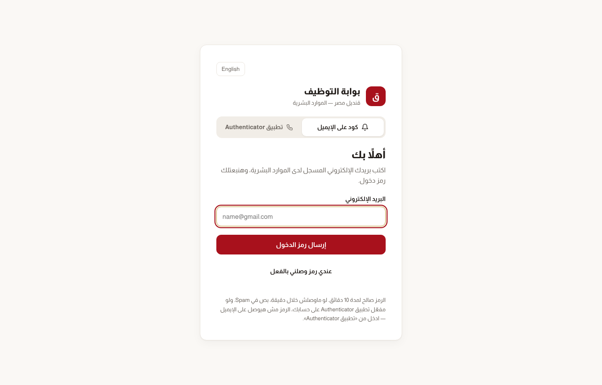

**الرئيسية** فيها أربع أرقام (مستني اعتمادك، طلباتك الجارية، رجعت للتعديل، الإشعارات)، وتحتهم **«المطلوب منك»**: كل سطر بيفتح المكان اللي هتشتغل فيه. الجرس فوق فيه الإشعارات، وزرار English بيغيّر اللغة.

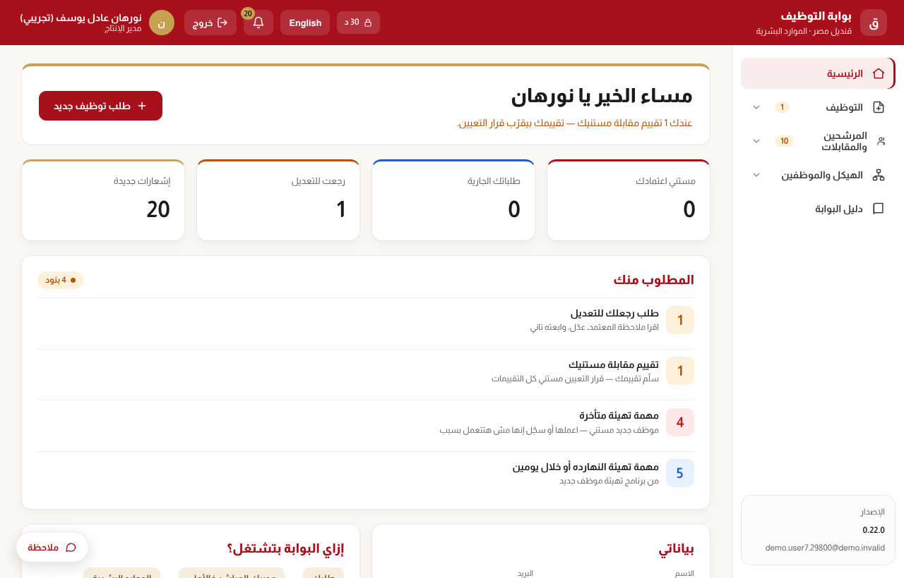

لو سيبت البوابة مفتوحة من غير استخدام، بتتقفل لوحدها بعد 30 دقيقة (العداد فوق جنب القفل).

## 2. طلب توظيف

الطلب بيتعمل من البوابة بدل النموذج HR-REC-F02، وبيمشي لوحده على مسار الاعتماد.

1. من القايمة: **التوظيف ← طلب توظيف** (أو زرار «طلب توظيف جديد» في الرئيسية).
2. اختار الوظيفة — بتظهرلك وظايف وحدتك واللي تحتها بس، وجنب كل واحدة العدد المعتمد والفعلي والمتاح.
3. حدد العدد لكل موقع (ممكن أكتر من موقع في نفس الطلب)، وسبب الاحتياج، ولو استبدال اختار الموظف اللي مشي.
4. اكتب الشروط والمهارات، والأولوية اللي تشوفها (الحرجة محتاجة سبب).
5. **«حفظ مسودة»** لو لسه مش خلصت، أو **«إرسال»** عشان يبدأ الاعتماد.

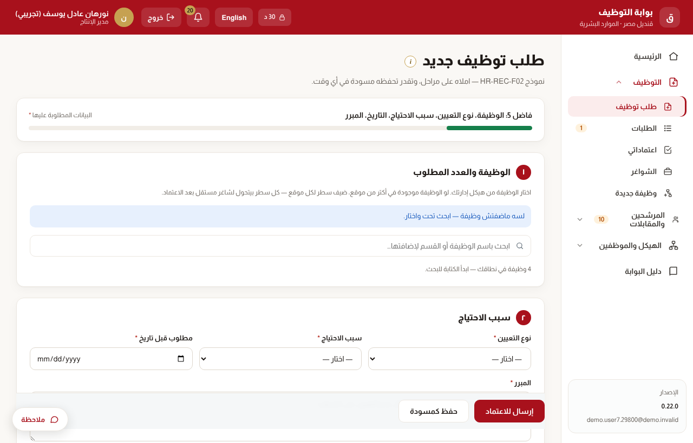

**لو طلبت أكتر من المتاح بالهيكل** البوابة مابتمنعكش، بس بتطلب مبرر وبتضيف خطوة «استثناء العدد» للمسار.

**المتابعة:** من **التوظيف ← الطلبات** افتح أي طلب تشوف هو عند مين ومن إمتى، والسجل الزمني بكل اللي حصل. بيوصلك إشعار مع كل اعتماد أو تعديل من الموارد البشرية.

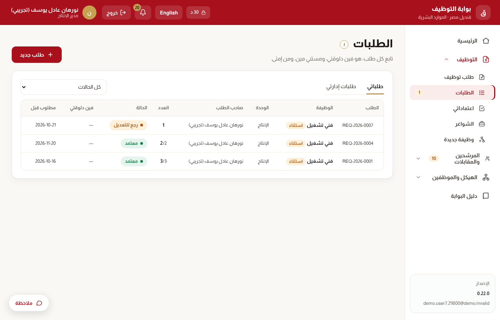

**لو الطلب رجعلك للتعديل:** اقرا ملاحظة المعتمد، عدّل، وابعته تاني — بيبدأ المسار من الأول بإصدار جديد، والنسخة القديمة بتفضل محفوظة.

## 3. الاعتماد

لو طلب من وحدة تحتك وصل لخطوتك، بيظهر في **«اعتماداتي»** وفي الرئيسية، وبيوصلك إشعار وإيميل. الأقدم فوق.

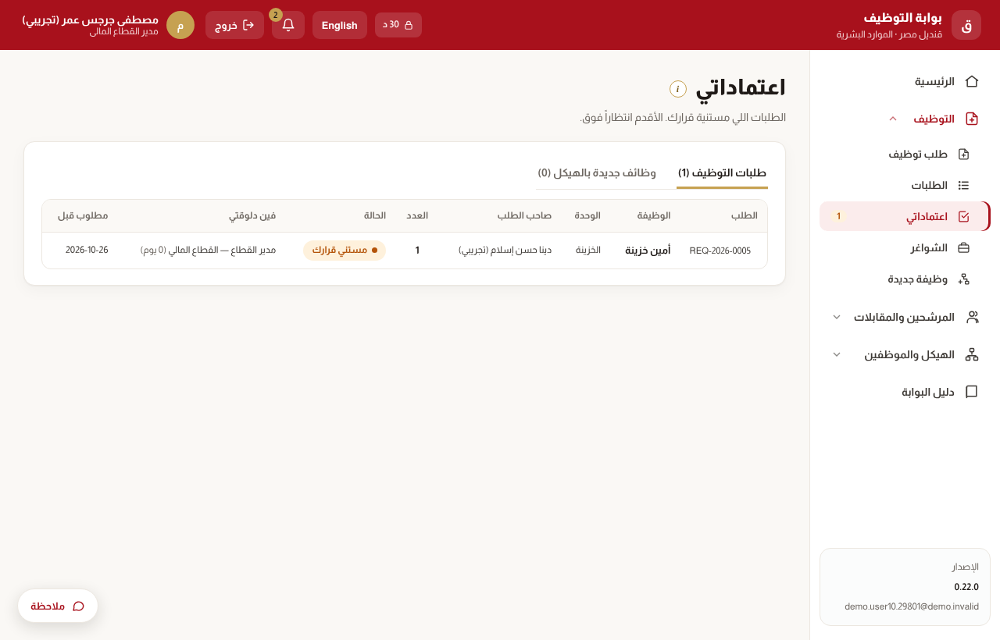

افتح الطلب: هتشوف بياناته ومسار الاعتماد والسجل، وكارت **«قرارك مطلوب»** فيه تلات اختيارات:

- **اعتماد** — التعليق اختياري، والطلب بيروح للخطوة الجاية.
- **إرجاع للتعديل** — اكتب المطلوب تعديله، والطلب بيرجع لصاحبه.
- **رفض** — بسبب إجباري، وصاحب الطلب بيشوفه.

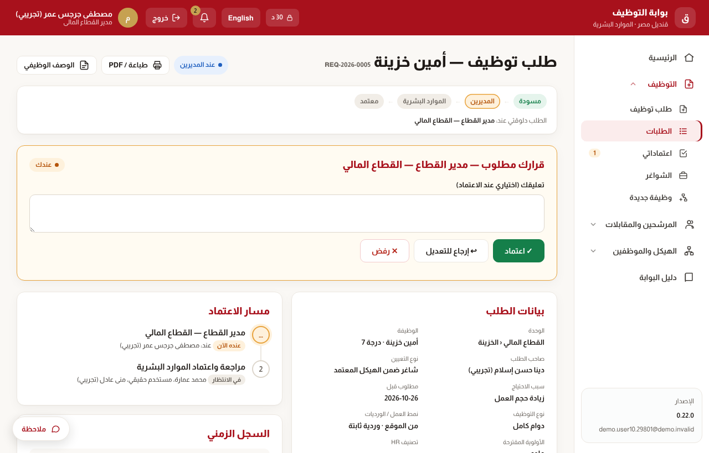

المسار بيتعمل لوحده من الهيكل: رئيس القسم ← مدير الإدارة ← مدير القطاع ← الموارد البشرية، والرئيس التنفيذي حسب القواعد. لو خطوة مالهاش حد أو انت صاحب الطلب، بتتخطى وسببها بيتسجل. ولو هتغيب، الموارد البشرية تقدر تعمل **تفويض** بتاريخ بداية ونهاية لحد يعتمد مكانك.

## 4. المقابلات والتقييم والاختيار

فريق التوظيف بيفرز المرشحين وبيحدد المقابلات، وانت دورك تلات حاجات: تأكّد المعاد، تقيّم، وتختار.

**أ) تأكيد المعاد.** لما تتحدد مقابلة انت المقابِل المسؤول فيها، بيوصلك إشعار وإيميل. افتح **«المقابلات»** واضغط **«أكّد»** أو **«اعتذر»** بسبب. المرشح مابيتبعتلوش دعوة غير بعد تأكيدك، فلو اتأخرت المقابلة بتتأخر.

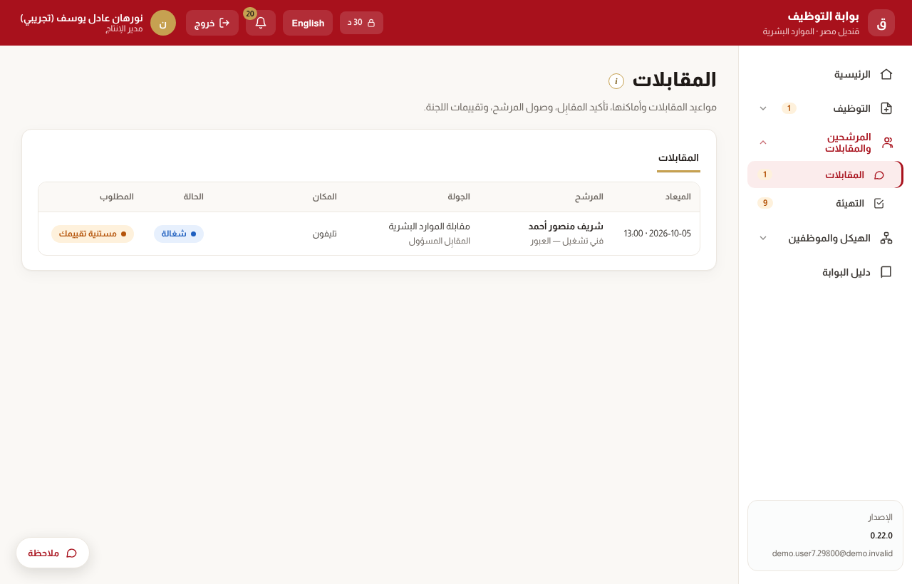

**ب) المقابلة والتقييم.** افتح المقابلة من الموبايل أو اللابتوب: هتلاقي بيانات المرشح وسيرته الذاتية والوصف الوظيفي والأسئلة المطلوبة. التقييم فيه:

1. المتطلبات الأساسية: متحقق / مش متحقق / محتاج تأكيد.
2. الكفاءات من 1 لـ 5، مقارنة بالمستوى المطلوب للوظيفة.
3. الأسئلة (الإجباري لازم يتسأل).
4. التوصية.

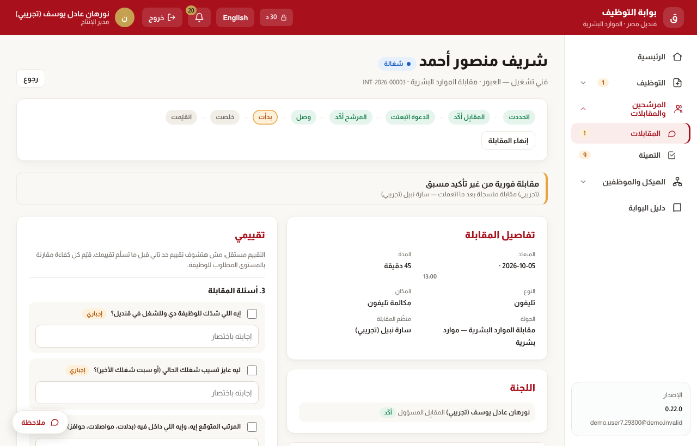

التقييم **مستقل**: مش هتشوف تقييم حد تاني قبل ما تسلّم تقييمك. سلّمه خلال 24 ساعة من المقابلة — المتأخر بيتبعتله تذكير، وبعدين بيتصعّد لمديري التوظيف.

**ج) المقارنة والاختيار.** من الشاغر ← **«مقارنة المرشحين»**: كل مرشح بجولاته وتقييماته وتوصياته وجاهزيته للقرار. لما يبقى «جاهز للقرار» سجّل قرارك من صفحة المرشح: **مختار** أو **احتياطي** أو **محتاج مقابلة إضافية**. الرفض والعرض والمرتب شغل فريق التوظيف — انت بتشوف حالة العرض من غير أرقام.

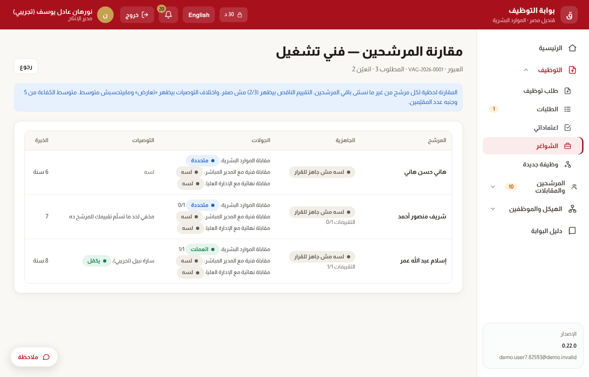

## 5. التهيئة واليوم الأول

أول ما ميعاد استلام الموظف الجديد يتأكد، البوابة بتعمل **برنامج تهيئة** بمهام ومواعيد، وكل مهمة ليها مسؤول. مهامك بتظهر في «المطلوب منك» وفي **المرشحين والمقابلات ← التهيئة ← «مهامي»**.

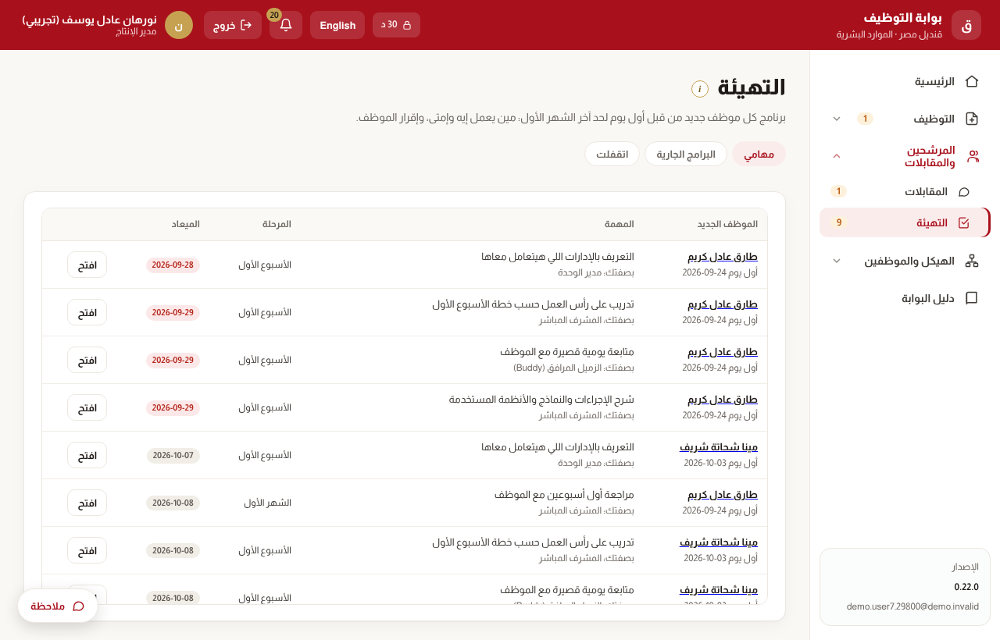

| مين | دوره |
| --- | --- |
| مدير الوحدة | يجهّز المكان، يستقبل الموظف أول يوم، ويحدد الـ Buddy |
| المشرف المباشر | تدريب أول أسبوع، ومتابعة أول شهر |
| الـ Buddy (زميل مرافق) | يعرّف الموظف بالمكان والناس ويرد على أسئلته |
| أخصائي HR الموقع | الملف والمسوغات والتأمينات واللوائح |

في صفحة البرنامج:

- بعد ما تعمل المهمة اضغط **«اتعملت»** — ولو المهمة محتاجة إقرار الموظف، علّم إنه أقر.
- مهمة مش هتتعمل ← **«مش هتتعمل»** بسبب.
- **«المسؤولين والـ Buddy»** لتحديد الـ Buddy، و\*\*«مهمة»\*\* لإضافة مهمة خاصة بالوظيفة.

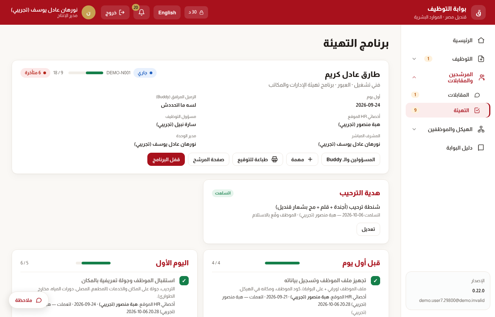

المهام المتأخرة بيتبعت بيها تذكير مرة واحدة. وبعد أسبوع وشهر، الموظف بيوصله استبيان «صوت الموظف الجديد» — الرد بيروح للموارد البشرية بس، مش للمدير.

## 6. وظيفة جديدة والنقل الداخلي

**وظيفة مش موجودة في الهيكل:** من **التوظيف ← وظيفة جديدة** اكتب المسمى والوحدة والمبرر. الطلب بيعدّي على مديرين الإدارة، بعدين توصية الموارد البشرية والدرجة، بعدين الرئيس التنفيذي ومجلس الإدارة. بعد الاعتماد الوظيفة بتتضاف للهيكل لوحدها، وتقدر تطلب توظيف عليها.

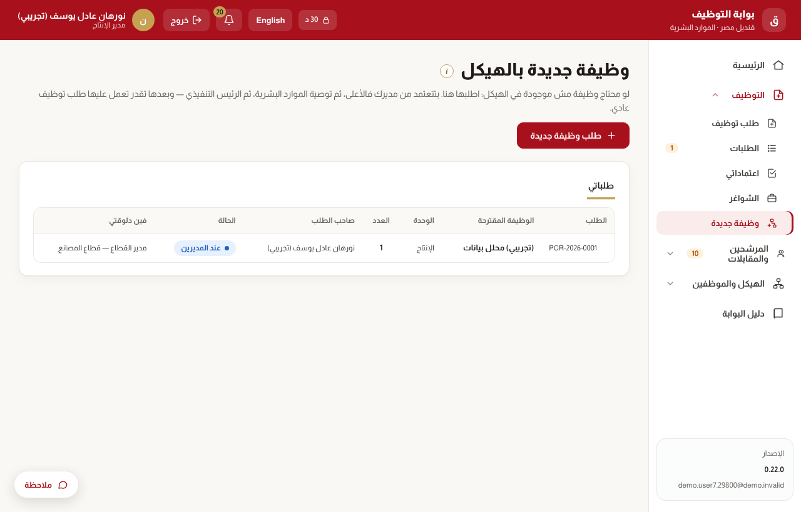

**نقل موظف من عندك لوظيفة تانية:** من **الهيكل والموظفين ← النقل الداخلي ← «طلب نقل داخلي»**.

1. اختار الموظف والوظيفة الجديدة — البوابة بتعرض بس الوظايف اللي فيها مكان أو شاغر مفتوح.
2. حدد تاريخ النقل، وأي تغيير في المواعيد أو الموقع.
3. الاعتمادات بالترتيب: المدير الحالي ← المدير الجديد ← مدير الموارد البشرية (ومدير القطاع لو مفردات المرتب هتتغير).
4. يوم النقل الموظف بيتنقل لوحده، والعدد بيتحسب تاني، والمديرين بيوصلهم إشعار.

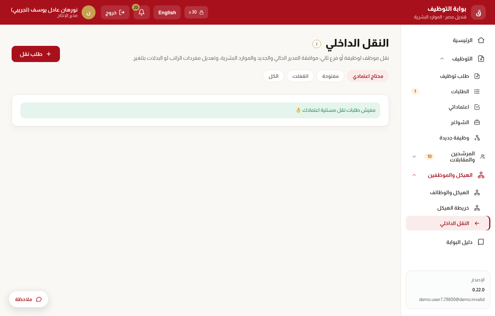

المبالغ مش بتظهر للمديرين — بتشوف إن فيه تعديل مفردات مرتب من غير أرقام.

## 7. أسئلة شائعة

| السؤال | الإجابة |
| --- | --- |
| الكود ماوصلنيش | شوف الـ Spam، واستنى دقيقة. بعد 3 أكواد في ربع ساعة اكتب آخر كود وصلك من «عندي رمز وصلني بالفعل». |
| غيّرت الموبايل أو ضاع | ادخل بكود من أكواد الاسترداد، أو اطلب «إعادة ضبط» من مدير النظام. |
| مش لاقي وظيفة في طلب التوظيف | الطلب بيعرض وظايف وحدتك بس. لو الوظيفة مش في الهيكل اطلب «وظيفة جديدة»، ولو وحدتك غلط كلّم الموارد البشرية. |
| الطلب واقف عند حد | افتح الطلب: هتشوف هو عند مين وبقاله كام يوم. البوابة بتفكّره وبتصعّد لوحدها. |
| ليه مش شايف المرتب المتوقع للمرشح؟ | المرتبات لفريق التوظيف واللي بيعتمدوا العروض بس — حماية للبيانات. |
| مش هقدر أحضر مقابلة | اضغط «اعتذر» بسبب بدري، عشان فريق التوظيف يحدد معاد جديد قبل ما المرشح يتحرك. |
| عندي ملاحظة على البوابة | زرار **«ملاحظة»** تحت في أي شاشة — بتوصل لمدير النظام باسم الشاشة، وبيوصلك الرد. |

للتفاصيل: **«دليل البوابة»** آخر القايمة، وعلامة ⓘ جنب عنوان أي شاشة بتشرح هي لمين وتبدأ منين.
