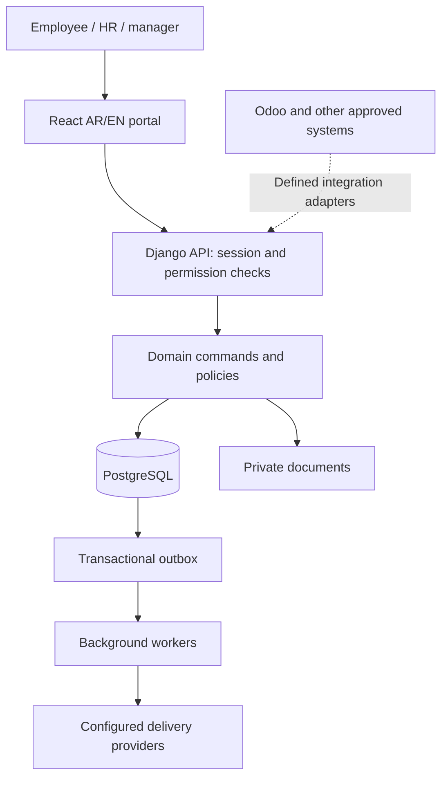

# قنديل HR — custom-system design and delivery plan

Planning draft · 15 October 2026 · no custom-backend implementation claimed

**Updated after fresh reference-source review:** use [SPRINTS.md](SPRINTS.md) for the detailed N00–N25 schedule (104 work items), [SOURCE_REVIEW.md](SOURCE_REVIEW.md) for examined evidence and limitations, and [DECISIONS.md](DECISIONS.md) for policy conflicts. The R0–R14 table below is the original grouping, retained for context. It is not the execution tracker.

## Purpose and current decision

Design a custom Arabic/English HR website for Kandil, with a new backend and a new private repository, independent of Frappe. Preserve the existing Frappe implementation as reference and fallback. Odoo remains independent. This is an internal company system, not a SaaS/RaaS product initiative.

This package plans the work; it does not create a new repository, provision hosting, migrate data or replace the current review environment. It lives temporarily in the existing repository so planning is versioned. Move it with its source references into the new repository during R2.

Confirmed constraints: 1,000+ intended users; Arabic/English and RTL; HR-first; GitHub source control; organization and individual employee-position changes use HR + CEO approval. Other approval routes follow their own requirements, not a universal CEO rule.

Proposed stack, pending architecture review: React/TypeScript frontend; Django/DRF backend; PostgreSQL; Celery/Redis for jobs; private object storage; Docker-based environments. Pin supported versions in R2 after compatibility checks. No hosting vendor or subscription is selected yet.

## Source baseline and scope

`../roadmap/reference-coverage.csv` contains 98 unique requirements. `requirements.csv` preserves every ID and requirement verbatim, assigns a proposed rebuild sprint and resets implementation/acceptance evidence for the new backend. Old Frappe passes are reference evidence only.

Reference scope includes access, organization, headcount, requests, vacancies, sourcing, candidates, interviews, offers, joining, documents, onboarding, transfers, probation and reporting. It also includes external dependencies such as shared sign-in with the Performance Appraisal portal. These stay tracked until implemented or explicitly changed by the owner.

Important compatibility decisions:

- ACC-001 mentions personal Gmail OTP and owner-only spreadsheets. Determine the required sign-in experience and translate spreadsheet ownership into equivalent database/export access controls. Do not silently mark the original wording satisfied.
- WAG-001 prohibits wage/payroll actions. Compensation information needed for authorized offers is distinct from calculating or paying payroll.
- Payroll, attendance/BioTime, leave, general employee letters, cost estimation and delivery tracking require additional scope decisions. They are not implied complete by the 98-item baseline.
- HR-letter generation should use its issuance date in Cairo. Decide explicitly whether downloading an old letter retrieves that original or issues a new version; never silently change an archived document's date.
- Insurance deadlines in the reference are business requirements needing HR/legal validation, not a legal conclusion from this plan.

Release levels: R3 is an internal proof, R4–R12 implement full reference coverage, R13 is readiness testing and R14 is a controlled pilot/rollout. A partial preview is never described as the full HR system. Any reduced pilot scope must list excluded IDs without removing them from the backlog.

## Product and design outputs

R0 produces a product brief, scope map, glossary, role matrix, workflow catalogue and decision register. For each workflow record trigger, actors, states, inputs, approval authority, exceptions, notifications, version rules, audit requirements and acceptance examples.

R1 produces navigation, role journeys, wireframes, a reusable visual system and an Arabic/English clickable prototype. Use realistic synthetic data. Cover employee, requester/manager, recruiter, interviewer, HR, leadership and IT roles. Include mobile, keyboard/focus, empty/loading/denied/error states, large tables, long Arabic names, date/number formatting and interrupted submissions.

Prototype walkthrough: scoped sign-in → hiring request → return and revision → appropriate approval → vacancy → candidate intake → activity/follow-up. Include unauthorized, duplicate and stale-record examples. HR reviews actual tasks rather than screenshots alone.

Approval means the named reviewer accepts a documented version. Design acceptance does not mean security or functional acceptance.

## Architecture blueprint

Use one backend deployment with separated domain modules: identity/access, organization, hiring, recruitment, candidates, interviews, offers, employee lifecycle, documents/privacy, communications and reporting. This is a modular monolith: one application, clear module ownership, one transactional PostgreSQL database initially.



Serve frontend/API under one origin where practical. Prefer secure cookie sessions with CSRF protection for the first-party web client; finalize SSO/OTP/MFA separately. No browser database access or admin service credentials. Candidate public links use separately scoped, expiring tokens and public-route abuse controls.

Domain ownership:

| Module | Owns | Key invariant |
|---|---|---|
| Identity/access | Account, role, scoped grant, delegation | Server resolves current authority; no self-escalation |
| Organization | Entity, branch, department, job, position, assignment, JD revision | Effective dates and approved structural history preserved |
| Hiring | Request, location line, approval step, decision snapshot | Material edits require appropriate reapproval |
| Recruitment | Vacancy, capacity commitment, recruiter team | Concurrent actions do not over-allocate commitments |
| Candidates | Person, application, source/referral/agency records, activities | Person differs from application; no silent identity merge |
| Interviews/offers | Panels, evaluations, assessments, offer revisions | Independent evaluations and restricted compensation access |
| Employee lifecycle | Employee, joining, transfer, probation, onboarding | Accepted offer alone does not count as actual joining |
| Documents/privacy | File metadata, versions, notices, consent grants | Private content cannot be accessed through guessable identifiers |
| Communications | Templates, outbox, delivery attempts, receipts | Requested delivery differs from provider-confirmed delivery |
| Reporting | Permission-filtered read models and exports | Counts, exports and drill-downs honor the same scope |

Data-design outputs: ER diagram; field dictionary/classification; unique and foreign-key constraints; indexes for real queries; retention rules; source ownership matrix; migrations and synthetic fixtures. Preserve stable IDs, effective-dated records, money currency/precision and UTC event times with Cairo display/business rules.

API outputs: OpenAPI contracts, pagination/filtering, errors, permission expectations, version preconditions and idempotency behavior. Domain commands own transactions. Use row locks/constraints where needed, bounded retries and an atomic audit/outbox write. Notifications happen after commit; workers retry safely. Avoid a generic workflow engine before concrete routes are understood.

## Repository and reuse

Proposed new private repository name: `kandil-hr-web` (check availability and ownership before creation).

```text
frontend/          React source and component tests
backend/           Django project, domain modules, migrations, tests
infrastructure/    Local/staging/production configuration templates
tests/             API-contract and end-to-end acceptance suites
docs/product/      Scope, requirements and glossary
docs/design/       UX journeys, screens and visual system
docs/architecture/ Decisions, ERD, APIs and threat model
docs/delivery/     Sprint tracker and release evidence
```

Reuse requirements, business decisions, test scenarios, terminology and suitable React components. Assess component accessibility and coupling first. Replace Frappe-specific API/session adapters, ORM models, hooks and migrations; do not copy them as if framework-neutral. Review licenses before reusing third-party source. No Frappe runtime dependency is proposed for the new system.

Preserve the existing repo and unpublished work. Do not delete or bundle unrelated current changes into the planning checkpoint. Record both old/new source revisions for any migrated behavior. No real database or credentials enter either repository.

## Sprint plan

R0–R14 are ordered delivery groups, not a promise of 15 fixed-length sprints. Work in one- or two-week iterations after estimating the backlog; large groups, especially R7, split into multiple iterations. AI assistance does not remove review, integration or HR acceptance time.

| Group | Deliverables and work | Dependencies | Exit evidence |
|---|---|---|---|
| R0 — scope and discovery | Review all 98 IDs; map broader HR gaps; workflows, glossary, roles, source ownership and decision log | None | Every ID classified; unresolved policies have owner; proposed first release documented |
| R1 — UX and architecture | AR/EN prototype; ERD; API contracts; module boundaries; threat model; stack/reuse decisions | R0 baseline | Role walkthrough and architecture review recorded; first-flow contract agreed |
| R2 — engineering foundation | New private repo; build/setup; CI; account lifecycle; scoped access; audit; migration tooling; staging skeleton | R1 core contracts | Clean install and staging smoke; disabled-user and cross-scope denial tests; secrets excluded |
| R3 — complete proof flow | Minimal organization → request/revision → applicable approvals → vacancy → candidate; integrated React | R2 | Ordinary role accounts complete flow; duplicate retry, stale update and unauthorized action tests pass |
| R4 — full organization | Multi-entity structure, positions, headcount, JDs, assignments and reviewed imports | R3 | HR + CEO routes; effective-date and import reconciliation tests; AR/EN document checks |
| R5 — full request authority | All routing, delegation, exceptions, material changes, board path and approval snapshots | R4 | Every route and denied/self-approval path tested; concurrency preserves quantities |
| R6 — vacancy operations | Queues, scoring, multiple recruiters, ownership, lifecycle, notifications and dashboard | R5 | Scoped counts/bulk actions; notification retries and reassignment safety |
| R7 — candidates and sourcing | Identity/deduplication; public/recruiter intake; sources/ads; referrals/agencies; privacy/pool; activities/imports/messages | R6; can prepare contracts during R4–R6 | Exact mapped cases pass, including privacy, lost reply, source disputes and 50–100-row imports |
| R8 — interviews | Scheduling/confirmation, panels, assessments, questions, independent evaluations, SLA/escalation | R7 | Invitation gates, confidential evaluations, rescheduling and reminder tests |
| R9 — offers | Compensation authority, versions, approval, expiry/extension, negotiation and delivery | R8 | Restricted salary access; approved version delivered; duplicate sending/expiry tested |
| R10 — joining and files | Actual joining, no-shows, document review/deferral, onboarding, electronic files and initial insurance cases | R9 | Actual join updates capacity once; private file/access/expiry tests; human-reviewed insurance policy |
| R11 — employee lifecycle | Transfers, effective-date moves, replacement, probation and subsequent insurance cases | R10 | Repeated job execution cannot duplicate moves; leave/cancel/return cases preserve history |
| R12 — reports and shared identity | Request reports, role dashboards, evidence-only screening, appraisal shared-login integration | R7–R11; external identity contract | Source reconciliation, scoped exports and provider-backed SSO evidence; no autonomous rejection |
| R13 — release readiness | Complete 98-ID regression; HR UAT; independent security; load/soak; restore; migration rehearsal; operating costs/runbooks | Functional release scope complete | No unresolved critical release defects; sign-offs, recovery measurements and load report |
| R14 — controlled rollout | Trained small cohort; reconciled migration; support; pilot feedback; staged expansion | R13 approval | Pilot acceptance and rollback readiness before broad access; production monitoring active |

Each group has a tracker entry in `tracker.json`. Requirements mapping is in `requirements.csv`; all new-system requirements begin unimplemented/unverified. R3 is a proof subset, not evidence that R4–R12 are complete.

## Parallel work and ownership

Ibrahim owns product decisions and technical integration; HR owns workflow/policy/UAT; Kandil IT owns identity, hosting, operations and source-system access. Independent reviewers own security review. Named people must be assigned in R0; these are proposed responsibilities, not appointments.

After R0's scope baseline, UX design and architecture modelling can progress together. After R1's contracts, frontend (mocked contract), backend, acceptance tests and infrastructure can progress concurrently. Backend schema/API owner coordinates shared changes; one integration lane merges and verifies each complete flow. Test mocks never count as a connected acceptance pass.

Do not parallelize conflicting database migrations or mutate the same test fixture/database. Isolate developer/test environments and assign file/module ownership. This plan enables future parallel execution; no agents are dispatched by this planning task.

## Security, privacy and operational design

Begin threat modelling in R1 and tests in R2. Cover authentication/recovery/OTP abuse, session expiry, CSRF, XSS, IDOR, bulk endpoints, exports, role changes, public candidate links, uploads and logs. Explicitly deny unauthorized records/fields; test counts and downloads as well as forms. MFA and privileged access policy must be selected before real-data rollout.

Use private file storage, size/type validation, quarantined uploads and malware scanning before document release. Access to metadata does not automatically grant file download. Mask sensitive logs; define access to backups and audit records. Application append-only history is not tamper-proof against database administrators; evaluate independent audit retention and key custody.

Data retention, consent wording, regional hosting and deletion/hold policy require HR/legal decisions. Public applicant processing and any third-party AI require approved data handling. AI is optional and evidence-only initially, with no automated hiring rejection or privileged execution.

Background jobs need retry limits, deduplication, dead-letter/error visibility and operational ownership. Environments must separate databases, credentials and provider endpoints. Development/staging use synthetic data and captured/sandbox messages.

Proposed load experiments, not capacity promises: seed 1,500 synthetic accounts, exercise 50/100/250 active users with realistic think times and a mixed workload; add import/export and document workloads, a burst and a soak. HR/IT must validate realistic peak activity before accepting results. Measure p95 latency, errors, database locks, job lag and infrastructure usage. Initial acceptance targets for agreement: common interactive requests p95 under 2 seconds, unexpected errors under 1%, zero unauthorized reads or duplicate committed actions. Heavy exports are asynchronous with separate completion targets.

Proposed recovery targets for cost discussion: RPO at most 1 hour and RTO at most 4 hours. These are not current guarantees. Test isolated restoration including database, private files, encryption material and app versions; record actual times. Final targets depend on business impact and budget.

Budget worksheet must include staging and production app/database, storage/egress, backups, email/OTP, monitoring, domain/TLS operations, security review and maintenance. Provider selection and current prices are a separate research task; do not treat free-tier capacity as the production budget.

## Migration and release

Inventory authoritative sources before importing: original Sheets, Odoo-owned records and any approved HR exports. Existing synthetic Frappe review data is not a production source. Build dry-run mapping, validation/error queues, duplicate review, record counts and exception reconciliation; require a named HR reviewer.

Define a cutover window and source write freeze or controlled change capture. Import into staging first; rehearse with approved data under proper access. Document rollback triggers and data reconciliation for new writes; switching the URL alone is not a rollback after users create records. Keep old systems available according to agreed retention/access rules.

Release requires exact source revision, green relevant CI, requirement evidence, known defects, HR acceptance, security/load/restore results, approved identities/providers, monitoring, support ownership and rollback instructions. Roll out a small representative cohort before all intended users. Keep unimplemented broader HR modules explicit.

## Decision register

| ID | Decision still needed | Proposed owner | Needed by / provisional direction |
|---|---|---|---|
| D01 | First release scope and broader HR priorities | Ibrahim + HR | R0; preserve 98-item baseline, discover additions separately |
| D02 | Personal email OTP, organizational SSO, MFA and recovery | IT + HR | R1; no provider assumed, preserve ACC-001/002/004 mapping |
| D03 | Actual legal entities, branches and role scopes | HR | R0; reference mentions four entities, verify current structure |
| D04 | Approval exceptions, delegation, calendar and authority | HR/leadership | R1; individual/structural changes retain HR + CEO |
| D05 | Existing authoritative data and Odoo contracts | IT + HR | R1; no direct writes into Odoo database |
| D06 | Retention, consent text, hosting region and sensitive fields | HR/legal + IT | Before public intake/real data; no invented policy |
| D07 | Hosting budget, availability, recovery and peak usage | Ibrahim + IT | R2 shortlist; R13 final acceptance |
| D08 | Prototype reviewer and brand/accessibility expectations | HR + Ibrahim | R1; AR/EN and mobile required |
| D09 | Repository ownership/name and operations owner | Ibrahim + Kandil | R2; private repo with Kandil-controlled long-term access |
| D10 | Email/WhatsApp delivery vs manual copy | HR + IT | Before delivery implementation; provider proof distinct from copy |
| D11 | HR-letter reissue versus original download behavior | HR | Before adding employee letters |
| D12 | Pilot cohort, sign-off owners and rollout schedule | HR + IT | Before R13; no promised release date yet |

## Immediate next work and tracker rules

Next: complete N00's product brief, role/workflow inventory and decision register; then create N01/N02's prototype and architecture package. Repository creation and backend coding start in N03 after the core contracts are reviewed. No paid service is necessary to write the design package.

Tracker states: planned → in progress → engineering verified → HR accepted → released; blocked records a specific dependency and owner. Completion requires evidence links and source revision. Never infer a percentage from code volume, agent activity or old Frappe test totals. All current rebuild implementation entries remain planned.

Planning acceptance: 98 unique IDs preserved; every ID assigned; explicit scope gaps; each sprint has dependencies and exit evidence; ownership and open decisions visible. Product/HR approval of this draft remains pending.
